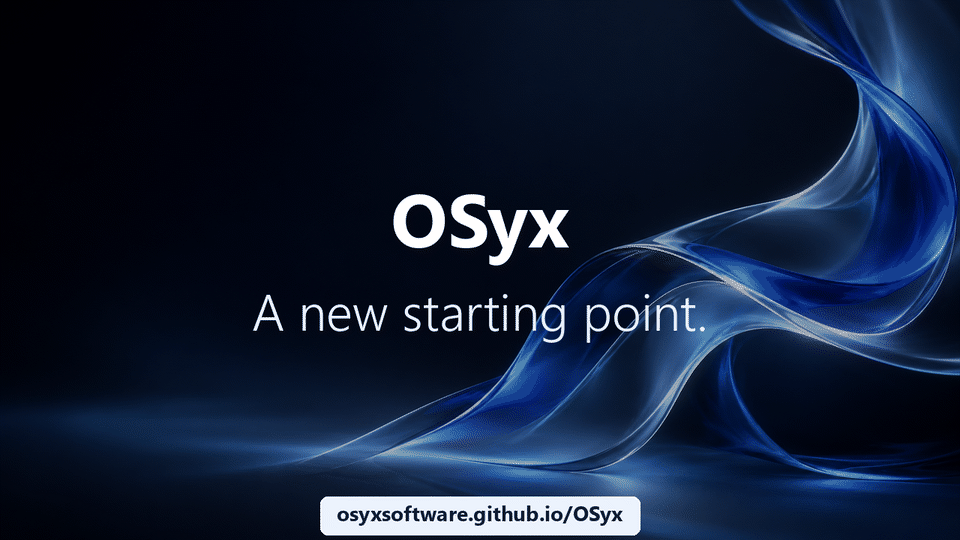

<div align="center">

# OSyx

**A new x86-64 operating system, written from scratch in Rust.**

[](https://github.com/OSyxSoftware/OSyx/actions/workflows/ci.yml)

Its own UEFI boot manager, kernel, file systems, network stack, compositor
and desktop, and a compatibility layer that runs Windows PE32+ programs.

**Status:** under active development and not abandoned — see
[STATUS.md](STATUS.md) for what is being worked on.

[](https://osyxsoftware.github.io/OSyx/)

**[Visit osyxsoftware.github.io/OSyx →](https://osyxsoftware.github.io/OSyx/)**

</div>

## Screenshots

| | |
|:---:|:---:|
|  |  |
| **Launcher and Files** | **AXIS Terminal** |
|  |  |
| **Settings** | **Task Manager** |
|  |  |
| **A Windows program (Text Editor, PE32+)** | **OSyx Setup** |

## What it is

- **Boot**: OSyx Boot Manager, a graphical UEFI application that validates
  and starts the kernel.
- **Kernel**: SMP (ACPI MADT, APIC), 4-level paging with W^X, preemptive
  scheduler, ring 3 processes and threads, futexes, a system call ABI with
  pointer validation; 26 in-kernel self-tests.
- **Storage**: a native journalled **ext4** driver as `/`, FAT32, tmpfs,
  devfs, GPT, NVMe, AHCI, VirtIO and USB mass storage.
- **Network**: Ethernet, ARP, IPv4, ICMP, DHCP, DNS, UDP and TCP with
  ring-3 sockets; HTTPS (rustls) for downloads and updates; Wi-Fi with WPA2.
- **Desktop**: PRISM, a compositor running as an ordinary process, with a
  panel, launcher, quick settings, notifications, desktop shortcuts and
  native applications (Files, AXIS Terminal, Settings, Task Manager, System
  Information, OSyx Setup).
- **Windows programs**: `winrun` loads PE32+ programs and DLLs with
  original implementations of a subset of ntdll, kernel32, user32/gdi32,
  comdlg32, Winsock and more. The Zen Browser (Windows build) runs on it.
- **Drivers** written for OSyx, plus OpenBSD drivers through a small
  compatibility layer: `re(4)` (Realtek Ethernet), `iwm(4)` (Intel Wi-Fi)
  with net80211, `azalia(4)` (HD Audio).

Real hardware it is tested on: Lenovo ThinkPad T495 (AMD Ryzen, Intel
Wireless-AC 9260, Realtek Ethernet, Realtek ALC257). Everything else runs
in QEMU with OVMF in the automated tests.

## Try it

1. Download `osyx-<version>-live-usb.img` from
   [Releases](https://github.com/OSyxSoftware/OSyx/releases) and write it to a USB
   stick (Rufus, balenaEtcher or `dd`; this erases the stick).
2. Boot the computer from the stick (x86-64 UEFI, Secure Boot off, at least 512 MiB of RAM).
   The live system runs entirely in RAM and touches no disk.
3. To install, connect to the Internet (Wi-Fi in quick settings, or a
   cable) and open **Install OSyx** on the desktop. Setup erases the disk
   you choose.

## Updates

Installed systems keep themselves up to date. `/bin/osyx-update` checks the
latest [release](https://github.com/OSyxSoftware/OSyx/releases) once a day,
verifies its Ed25519 signature against the key built into the system and
installs the new programs, kernel and boot loader; your settings and files
in `/etc`, `/home` and `/var` stay as they are. A notification asks for a
restart when an update is installed. The previous kernel stays as
`KERNEL.OLD` on the EFI partition.

Publishing a release (maintainers):

```powershell
.\scripts\release.ps1 -Version 0.2.0   # signed update + live images in build\release
```

## Build

On a Windows 11 host with Rust, MSYS2 (QEMU, OVMF, clang) and WSL
(Ubuntu 24.04 with e2fsprogs):

```powershell
.\scripts\check-env.ps1          # verify Rust targets, QEMU, OVMF
.\scripts\build.ps1 -Live        # live USB image and ISO (build\osyx-live-usb.img)
.\scripts\run-qemu.ps1           # build and boot the desktop in a QEMU window
.\scripts\test.ps1               # host unit tests and QEMU tests
.\scripts\net-test.ps1           # network tests in QEMU
```

Only image files under `build/` are written; no host disk is touched.

## Source tree

| Path | Contents |
|---|---|
| `boot/` | UEFI boot manager, ELF validation, boot graphics |
| `kernel/` | the kernel and its drivers |
| `drivers/bsd/` | OpenBSD drivers and their compatibility layer |
| `storage/` | ext4, FAT32, VFS, tmpfs, GPT, 7-Zip reader |
| `network/` | the network stack |
| `graphics/` | PRISM compositor, protocol, UI toolkit |
| `compatibility/` | PE parser and loader, Win32 subsystem (`winrun`) |
| `runtime/` | system calls and OSyx Std |
| `userspace/` | init, desktop and applications, Setup, HTTPS tools, updates |
| `shared/` | boot protocol, system call ABI, crypto, input, update manifest |
| `docs/` | design documentation; [overview](docs/overview.md), [architecture](docs/architecture.md) |

## License

OSyx is free software under the GNU General Public License, version 3 or
later (`GPL-3.0-or-later`, see [LICENSE](LICENSE)).

**Additional permission (GPL-3.0 section 7).** Some OpenBSD files in
`drivers/bsd/openbsd` (for example the Realtek Ethernet driver `re.c`)
carry the original four-clause BSD licence. As an additional permission,
the copyright holders of OSyx allow you to combine OSyx with those files
and to distribute the combination, provided those files keep their own
licence and notices.

Third-party parts keep their own licences: the OpenBSD and NetBSD sources in
`drivers/bsd` (ISC and BSD, notices in each file), Intel device firmware in
`drivers/bsd/firmware` (`LICENCE.iwlwifi_firmware`, `LICENCE.ibt_firmware`),
the bundled fonts (SIL OFL) and the Rust crates from crates.io.

## Support

OSyx is developed in spare time and has no company behind it. If you find it
useful and want to help it continue, you can support the work through:

- [GitHub Sponsors](https://github.com/sponsors/v3nn7)
- [Ko-fi](https://ko-fi.com/v3nn7)

Sponsoring is entirely optional. It does not buy placement in the roadmap —
the best way to influence the project is still a good bug report or a pull
request.

## Contributing

See [CONTRIBUTING.md](CONTRIBUTING.md) for development, testing and pull requests. Report security issues as described in [SECURITY.md](SECURITY.md).
